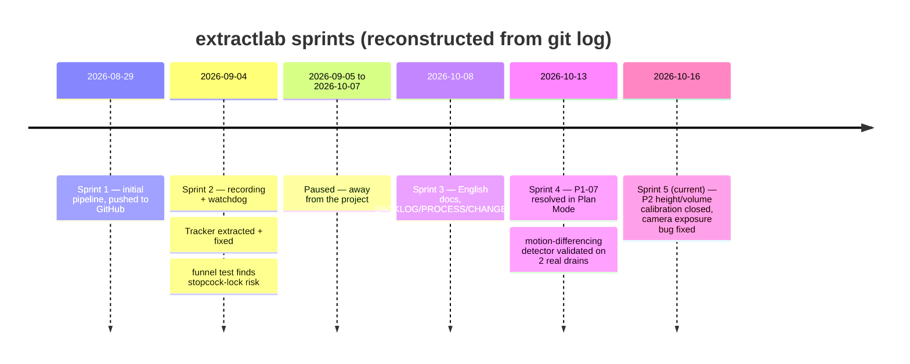

# 03 — Sprints

Reconstructed from `git log`, not planned in advance on a fixed calendar — this is a solo project with irregular
availability (a month-long gap is visible below), so a sprint here means "one dated unit of work," not a fixed
weekly cadence.

| Sprint | Dates | Scope (story IDs) | Outcome |
|---|---|---|---|
| Sprint 1 | 2026-08-29 | `P0-01`, `P0-02`, `P0-03`, `P0-07` | Initial pipeline committed, pushed to GitHub |
| Sprint 2 | 2026-09-04 | `P0-04`, `P0-05`, `P0-06`, `P1-01`-`P1-06` | Recording + watchdog shipped; `Tracker` extracted and fixed (replay 151 -> 12 px); real-funnel test found the stopcock-lock risk |
| *(paused)* | 2026-09-05 - 2026-10-07 | — | Away from the project |
| Sprint 3 | 2026-10-08 | docs translation, `BACKLOG.md`/`PROCESS.md`/`CHANGELOG.md`, architecture + logic diagrams | Full English documentation trail established |
| Sprint 4 | 2026-10-13 | `P1-06`, `P1-07`, docs sync | Resolved `P1-07` in Plan Mode (the stopcock-lock finding was specific to the funnel's old configuration) — no new detector needed; the stopcock was then physically removed from the funnel; built a motion-differencing detector as a second, parallel path and validated it against two real drains; the advisor confirmed cyclohexane is out of scope (water-oil is the final pair) — synced every doc to the real hardware/scope |
| **Sprint 5 (current)** | 2026-10-16 - | `P2-02`, `P2-03`, `P2-04` | Built and validated two height/volume calibration tables (ruler-based, RMSE 0.589 mL; camera-direct, RMSE 0.436 mL); found and fixed a real camera repeatability bug (`EXPOSURE_US` too low caused a 43px spread across repeat reads and an intermittent false lock on the bulb/cone edge) — closes Epic P2 |

Sprint 2's single day covers more than it looks like it should — most of P0's remaining items and most of P1
landed in one long session; `CHANGELOG.md` has the dated, per-item breakdown if the granularity here isn't
enough.
