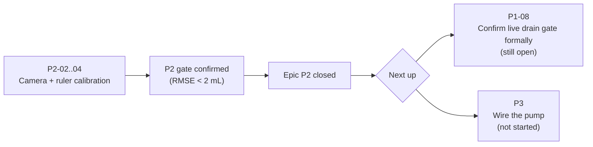

# 05 — Sprint Backlog (current — Sprint 5)

What's actually being worked on right now, nothing else.

| ID | Story | Status |
|---|---|---|
| P2-02 | Calibrate `boundary_y` -> `volume_ml` directly from the camera | **Done** — RMSE 0.436 mL |
| P2-03 | Build calibration tables from known volumes | **Done** — ruler-based + camera-direct |
| P2-04 | Verify against held-out volumes (target RMSE < 2 mL) | **Done** — 0.589 mL / 0.436 mL |

Epic P2 closed this sprint: two calibration tables built and validated (ruler-based, RMSE 0.589 mL; camera-direct,
RMSE 0.436 mL), and a real camera repeatability bug found and fixed along the way (`EXPOSURE_US` too low — see
`../BACKLOG.md` epic P2 and `records/pixel_calibration.json` for the full investigation).

Two items remain open from earlier work and aren't yet claimed by a sprint: `P1-08` (confirm the P1 gate on a
formally-logged live drain — strong replay/live evidence already exists, just not yet checked off) and Epic P3
(wire the pump). Neither has started as of this sprint backlog.

This file gets replaced wholesale at the start of each sprint, not accumulated — history lives in
`03_sprints.md` and `../CHANGELOG.md`, not here.
